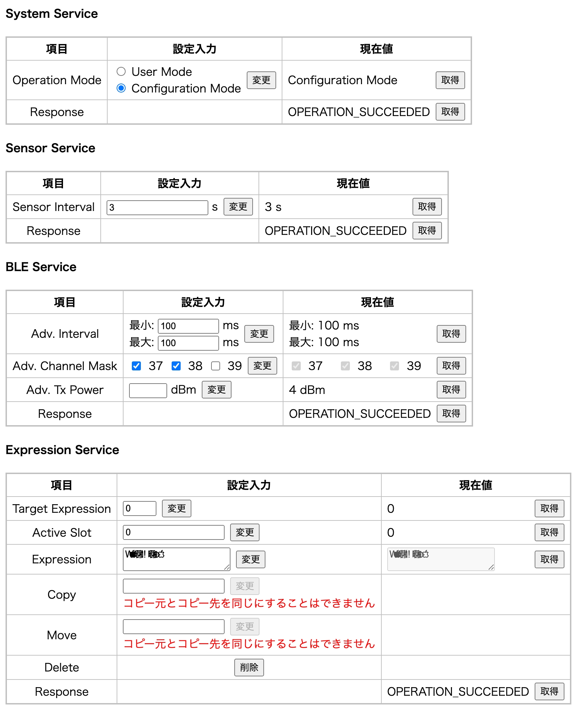
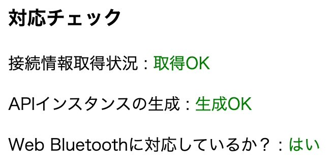

# IoTSensorModule-WebAPI
[内藤研究室(Pluslab)](https://github.com/Pluslab)において開発した[IoTセンサーモジュール](https://github.com/Pluslab/iot-sensor-module)にWebからアクセスできる機能を提供するWeb APIライブラリです。




## レポジトリ構成要素
本レポジトリは以下の構成となっております。

### ./src/
APIのソースファイルが格納されている部分になります。
エントリーファイルは"[main.ts](./src/main.ts)"です。
サブディレクトリは次のように構成されています：

| サブディレクトリ名 | 内容 |
| --- | --- |
| [enums](./src/enums/) | 列挙子の定義ファイル |
| [errors](./src/errors/) | 独自エラーの定義ファイル |
| [interfaces](./src/interfaces/) | 構造体の定義ファイル |
| [utils](./src/utils/) | ユーティリティモジュールのソースファイル |

### ./sample/
本Web APIを利用した、サンプルのサイトページのソースファイルです。
エントリーファイルは"[index.html](./sample/index.html)"です。

なお、このサンプルページのディレクトリ内に含まれるJavaScriptソースファイルは、サンプルページのJavaScriptのみです。
Web APIのソースファイルはビルド後に生成される"./dist/iot_sensor_module_api.mjs"を参照します。
サンプルページの利用には一度Web APIのソースファイルをビルドする必要があります。
詳しくはWeb APIの「[ビルド手順](#ビルド手順)」の章を参照してください。


## Web API開発の技術要素
Web APIのソースファイルは[TypeScript](https://www.typescriptlang.org/)で記述されています。
[Node.js](https://nodejs.org/ja)のTypeScriptパッケージを用いて、TypeScriptソースファイルをコンパイルし、JavaScriptソースファイルにコンパイルします。
更に[Viteパッケージ](https://vite.dev/)を用いて、複数のコンパイル済みJavaScriptソースファイルを単一のJavaScriptのソースファイルに纏め、扱いやすくします。


## ビルド手順
1.	Node.jsをインストールします。
	インストールの方法は様々ありますが、MacOSにおいては[Homebrew](https://brew.sh/)を用いると簡単にインストールができます。

	```sh
	# Node.jsのバージョン管理ツールをインストール
	$ brew install n

	# Node.jsをインストール（以下のコマンドのいずれかを実行）
	$ n lts # 安定版
	$ n latest # 最新版

	# Node.jsのバージョンを選択（下記のコマンド実行後に表示されるダイヤログに従い、選択する。）
	$ n

	# インストール確認
	$ node -v
	# [出力例] v25.4.0 <- 選択したバージョン番号が表示されればOK！
	```

2.	本レポジトリをクローン（ダウンロード）し、ダウンロードしたレポジトリのルートディレクトリに移動します。

	```sh
	$ git clone https://github.com/Pluslab/iot-sensor-module.git
	$ cd ${path_to_repository_root}
	```

3.	npmより、必要な依存パッケージをインストールします。

	```sh
	$ npm install
	```

4.	ソースファイルをビルドします。

	```sh
	$ npm build
	```

5.	`./dist/`ディレクトリとその中にビルド済みファイルが生成されたことを確認してください。

6.	"[./sample/index.html](./sample/index.html)"をブラウザで開いてください。
	または、[Visual Studio Code](https://code.visualstudio.com/)の[Live Serverプラグイン](https://marketplace.visualstudio.com/items?itemName=ritwickdey.LiveServer)などを用いてWebサーバーを構築してください。

7.	表示されたページ上部の「対応チェック」セクション内の項目が全て緑色であれば、正常にWeb APIのサンプルが利用可能です。
	「Web Bluetoothに対応しているか？」が緑色にならない場合は、「[Web Bluetooth APIについて](#web-bluetooth-apiについて)」のセクションを参照してください。

	


## Web APIの利用方法
> [!IMPORTANT]
> 利用の前に必ず「[Web Bluetooth APIについて](#web-bluetooth-apiについて)」セクションの注意事項を確認してください。

既存のWebページにビルド済みファイルをインポートするだけで利用可能です。

```js
// Web APIをインポート
import { IoTSensorModuleAPI } from './dist/iot_sensor_module_api.mjs';

// 接続相手のIoTセンサモジュールの情報を取得
const connectionConfig = await (await fetch('./data/module_data.json')).json();

// APIの初期化
const api = new IoTSensorModuleAPI(connectionConfig);

// この後の利用方法は、"./sample/js/iot_sensor_module_api_sample.js"を参考にしてください。
```

> [!NOTE]
> *	接続情報の取得先URLは適宜変更してください。
> *	実際のコードでは、`try ... catch`を用いたエラーハンドリングなどが必要です。

サンプルコードの途中で示した、接続情報については「[接続相手の情報について](#接続相手の情報について)」のセクションを参照してください。


## 接続相手の情報について
Web APIの初期化時には接続相手となるIoTセンサモジュールのサービスUUIDやキャラクタリスティックUUIDが格納された接続情報を引数として渡す必要があります。
接続情報はJson形式となっており、構造は次の通りです：

（"📄"は値を、"📁"は構造体を表します。）

```
📁 /
├ 📄 deviceName ... 相手の表示名
├ 📄 companyId ... 相手のベンダーのManufacture Specific DataのカンパニーID
├ 📄 numberOfTriggerData ... 相手が対応しているトリガーデータの数
└ 📁 services
  ├ 📁 <service_name_#1>
  │ ├ 📄 uuid ... サービスのUUID
  │ └ 📁 characteristics
  │   ├ 📁 <characteristic_name_#1>
  │   │ ├ 📄 uuid ... キャラクタリスティックのUUID
  │   │ ├ 📄 dataType ... キャラクタリスティックが取り扱うデータの型（Data Service、Log Serviceのみ）
  │   │ ├ 📄 logCount ... ログの最大エントリー数（Log Serviceのみ）
  │   │ └ 📄 unit ... データの単位の表示名
  │   ├ 📁 <characteristic_name_#2>
  │   └ ...
  ├ 📁 <service_name_#2>
  └ ...
```

"[./sample/data/](./sample/data/)"配下に接続情報のサンプルを格納してあるので参考にしてください。


## Web Bluetooth APIについて
本Web APIでは機能の実現のために、[Web Bluetooth API](https://developer.mozilla.org/ja/docs/Web/API/Web_Bluetooth_API)を使用しています。
Web Bluetooth APIはデバイスのBluetooth機能を介して、ブラウザ上から[BLE（Bluetooth Low Energy）](https://ja.wikipedia.org/wiki/Bluetooth_Low_Energy)デバイスにアクセスできる機能を提供します。

2026年2月16日現在、Web Bluetooth APIは普及していないため、利用においては以下の点に注意が必要です：

*	Web Bluetooth APIは主にPC版の[Chrome](https://www.google.co.jp/chrome/)、[Edge](https://www.microsoft.com/ja-jp/edge/download/)、[Opera](https://www.opera.com/ja)のみ対応しています。
	Android版のブラウザでも対応しているという情報もあります。
	対応表は[MDNのWeb Bluetooth API](https://developer.mozilla.org/ja/docs/Web/API/Web_Bluetooth_API#ブラウザーの互換性)の記事を確認してください。
*	Web Bluetooth APIのアドバタイズのスキャン機能を利用するには、ブラウザの実験的機能を有効にする必要があります。
	以下の手順に従って有効化してください。

	1.	ブラウザのアドレスバーに"chrome://flags/"と入力します（Chrome、Edge）。
	2. "Experimental Web Platform features"を有効にします。
	3. ブラウザを再起動します。
*	Web Bluetooth APIはブラウザのポリシーにより、"localhost"ドメインか、"http**s**://"で始まる場合のみしか利用できません。
*	Web Bluetooth APIはバックグラウンドで動作しません。
	Web Bluetooth API使用中に別のタブに切り替える、ウィンドウが非アクティブになるなどで動作を停止します。
